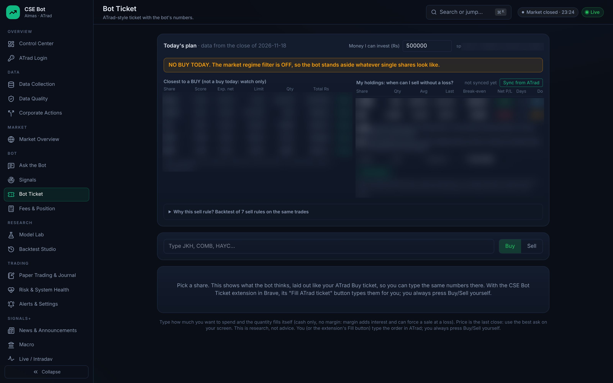
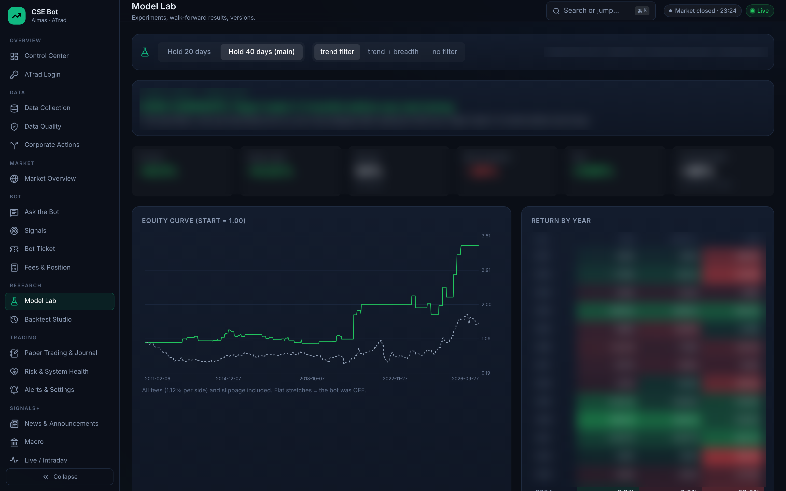
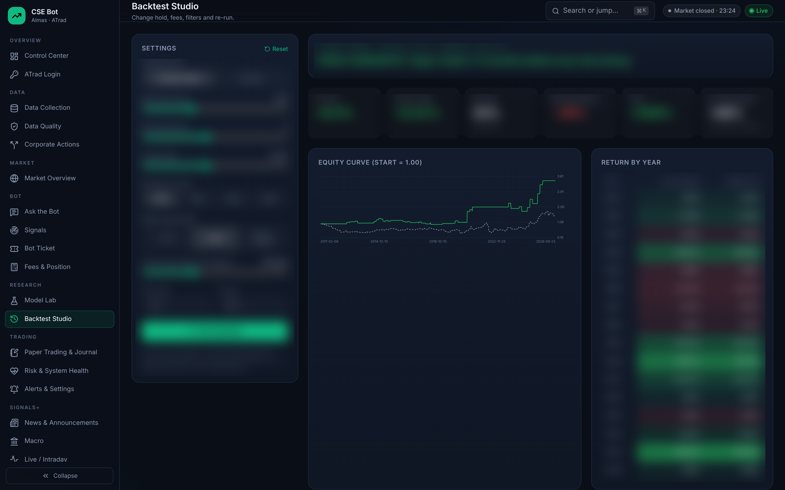

# CSE Signal Bot

**An end-to-end machine-learning research and signal platform for the Colombo Stock Exchange**

`Python` · `scikit-learn` · `pandas` · `Playwright` · `React 19` · `TypeScript` · `Tailwind CSS` · `SQLite` · `SQL Server`

*Private project. This repository is a showcase only: the source code, data and strategy are not public.*

---

## What it is

A personal project I designed and built end to end: a system that collects 15+ years of Colombo Stock Exchange market data, cleans it, trains and tests machine-learning models on it, and turns the results into clear daily guidance in a fast web dashboard.

It does not trade by itself. It gives research signals, and every order is placed by a person.

## Highlights

**Data engineering**
- Automated collection of 15+ years of daily prices for 700+ listed securities (1M+ rows), plus live intraday snapshots, announcements and market-wide flow data
- Corporate-action handling: splits and bonus issues are detected and adjusted so models never learn from false price jumps
- SQLite for speed, mirrored to SQL Server; daily automated cloud backups

**Machine learning**
- Gradient-boosting models evaluated with strict walk-forward testing (the model is only ever tested on a period it has never seen)
- Real-world costs built into every test: broker fees, exchange tick sizes and slippage
- Weekly automatic retraining with a safety gate: a new model replaces the old one only if it is not worse, with automatic backups

**Product**
- 18-page React + TypeScript dashboard: control center, data quality, model lab, backtest studio, paper trading, risk and system health, news, live intraday view
- Browser extension that pre-fills the broker's order ticket from the bot's numbers (the user always presses Buy or Sell)
- Phone and desktop push alerts; paper trading engine with a full journal

**Engineering quality**
- Unit, integration, UI and acceptance test suites
- Hardened local API (origin, host and header checks, input validation, crash-safe UI)
- Runs unattended on a Windows laptop: auto-start, scheduled jobs, self-recovery

*Numbers and settings are blurred on purpose.*

## What I learned

Building the model was the easy part. Most of the work was clean data, honest testing and good guardrails, and being willing to say "no edge" when the numbers say so.

---

## Work with me

I build **data pipelines, machine-learning systems, dashboards and full-stack web apps** for clients worldwide: scraping and ETL, analytics and forecasting, trading and fintech tools, React/TypeScript front ends, Python back ends.

Have a project in mind? Get in touch:

- **Email:** chinthakajayaweera1@gmail.com
- **Fiverr:** [fiverr.com/jkchinthaka](https://www.fiverr.com/jkchinthaka)
- **GitHub:** [@jkchinthaka](https://github.com/jkchinthaka)

I am happy to discuss a private demo of this system.

This project is for research and learning. Nothing here is investment advice.
